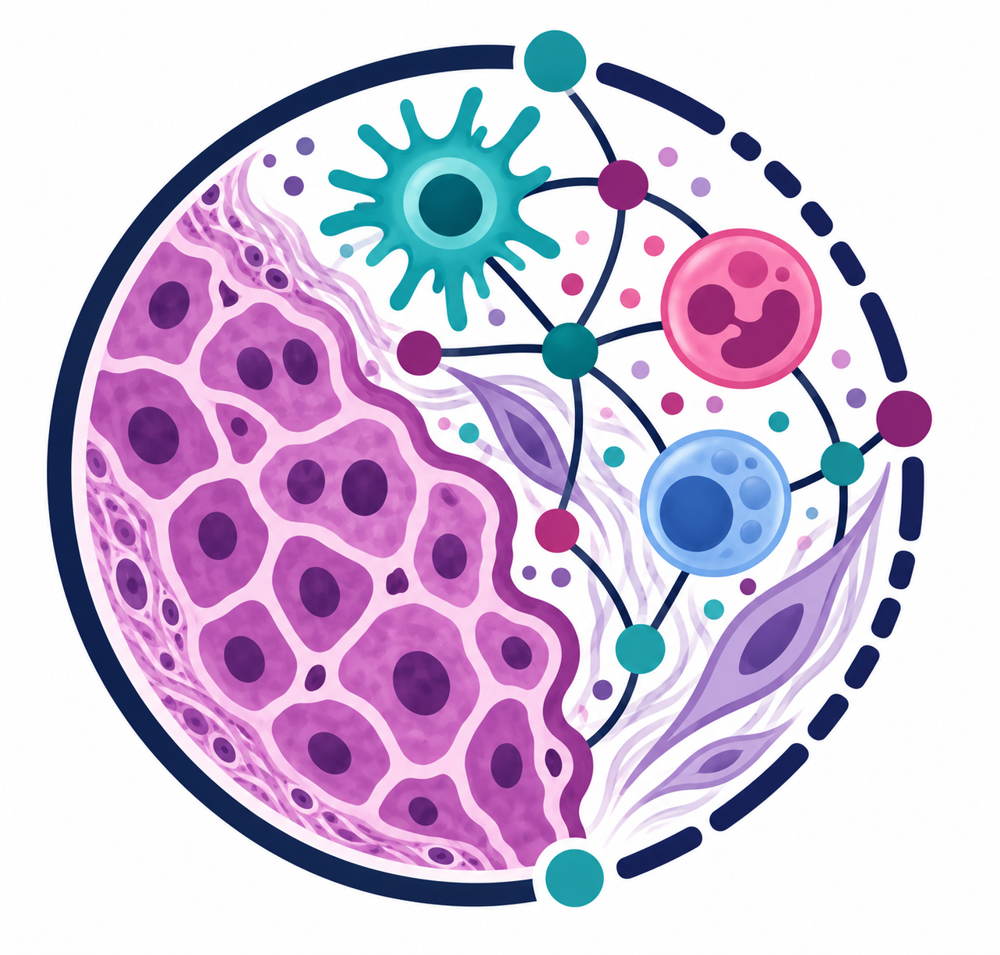
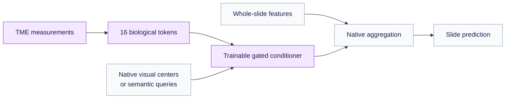

<p align="center">
  
</p>

<h1 align="center">TME-Context</h1>

<p align="center">
  <strong>Whole-slide learning, grounded in tumor biology.</strong><br>
  <em>Anonymous CVPR supplementary material</em>
</p>

<p align="center">
  <a href="#overview">Overview</a> ·
  <a href="#method">Method</a> ·
  <a href="#supported-architectures">Architectures</a> ·
  <a href="#study-design">Study design</a> ·
  <a href="#biological-panels">Panels</a> ·
  <a href="#getting-started">Getting started</a> ·
  <a href="#project-website">Website</a> ·
  <a href="#repository-layout">Layout</a> ·
  <a href="#acknowledgements">Acknowledgements</a>
</p>

---

<a name="overview"></a>

## 🔬 Overview

**TME-Context** studies how quantitative **tumor microenvironment (TME)**
measurements can condition whole-slide pathology models. Tissue organization,
cell composition, and spatial relationships provide biological context for
visual patch features.

The central question is: **does slide-specific biological context improve a
model's aggregation beyond its native representation and the capacity of an
added conditioner?**

This small supplement contains the reusable biological panels and conditioner,
text prompt banks, five patient-disjoint BRCA split definitions, and an
executable **BRCA · MUSE · CLIP-RN50 · actual-TME** adapter recipe. It contains
no whole-slide images, patch features, measured TME rows, model weights,
previous results, or test suite.

<a name="method"></a>

## 🧠 Method

Quantitative measurements are arranged into **16 biological tokens**. A
trainable cross-attention module reads those tokens and adds a gated residual
to a native model's visual centers or semantic queries. The native model stays
frozen during adapter training.



The actual-TME model needs measurements for each slide **at inference**.
Preprocessing is fitted on training slides only. Text prompts remain separate
from the numeric biological measurements.

<a name="supported-architectures"></a>

## 🧩 Supported architectures

The wider study applies the same biological interface at each architecture's
native query location. This folder provides prompt assets and the reusable
conditioner for all seven; the **MUSE/CLIP-RN50 BRCA actual-TME runner** is the
executable model integration included here.

| Architecture | Visual scales | TME-conditioned representation |
|---|---|---|
| ViLa-MIL | 5× + 10× | Image-center queries before patch aggregation |
| MGPATH | 5× + 10× | Image-center queries before graph aggregation |
| FOCUS | 20× | Encoded semantic queries before patch selection and final attention |
| **MUSE** | **10×** | **Inference class semantics before sparse expert routing** |
| HiVE-MIL | 5× + 20× | Hierarchical text nodes before filtering and graph construction |
| DyKo | 20× | Class queries after concept retrieval |
| MSCPT | 5× + 20× | Multiscale text graph representations |

The other native architecture implementations are not bundled in this small
folder. Their prompt inputs are retained in [the prompt banks](prompt_banks/README.md).

<a name="study-design"></a>

## 🧪 Study design

The wider comparison uses **16 shots per class**, **five patient-disjoint
folds**, paired **PLIP / CLIP-RN50** encoders, and matched cohort manifests.
The bundled protocol is the five-fold BRCA IDC-versus-ILC subset with
CLIP-RN50 feature filenames.

| Wider-study cohort | Classification task | Slides | Patients | Panel |
|---|---|---:|---:|---|
| TCGA-NSCLC | LUAD vs. LUSC | 1,041 | 944 | core62 |
| TCGA-BRCA | IDC vs. ILC | 960 | 900 | morph64; shared core62 in matched extensions |
| TCGA-CRC | Adenocarcinoma NOS vs. mucinous | 544 | 536 | core62 |
| TCGA-BLCA | Non-papillary vs. papillary | 451 | 380 | core62 |

| Condition | Biological input | Role |
|---|---|---|
| **Native** | No TME conditioner | Matched starting model |
| **Zero TME** | Standardized values set to zero | Added-capacity control |
| **Shuffled TME** | Another patient's row within the same split | Slide–TME matching control |
| **Actual TME** | The slide's own measurements | Biological-context arm |

Only **actual TME** is executable in this supplement. The native, zero, and
shuffled arms require their corresponding full-study runners. No performance
scores are bundled or claimed here. Patient-level probabilities are computed
by averaging a patient's slide probabilities.

<a name="biological-panels"></a>

## 🌿 Biological panels

The fixed panels use quantitative measurements from
[Aignostics / OpenTME](https://huggingface.co/datasets/Aignostics/OpenTME).

| Panel | Measurements | Biological token groups | Use here |
|---|---:|---:|---|
| `core62` | 62 | 5 tissue/TLS + 11 cell/spatial | Reusable schema |
| `morph64` | 64 | 6 tissue/morphology + 10 cell/spatial | BRCA MUSE run |

The [panel schema](tme_context/panels.json) lists every feature in its required
order, fixed percentage and `log1p` transforms, and token membership.
`core62` expects its four lymphoid presence/log-count variables to have been
derived; `morph64` expects two region-density variables to have been derived.
Missing measurements may be `NaN`; the fold's training rows determine median
imputation and scaling. These fixed definitions encode biological hypotheses,
not an optimized feature selection result.

<a name="getting-started"></a>

## 🚀 Getting started

Use Python 3.10 or newer. Install from inside this folder:

```bash
python -m venv .venv
. .venv/bin/activate
python -m pip install -e '.[hdf5]'
```

The BRCA MUSE runner needs **real inputs supplied separately**:

1. A directory of 10×, 224-pixel CLIP-RN50 HDF5 patch bags. Exact basenames
   are in [`splits/brca/16shot/`](splits/README.md). Each file has `features`
   shaped `[patches, 1024]` and matching `coords`.
2. A quantitative BRCA CSV with `slide_id` followed by the exact raw
   `morph64` columns in the [panel schema](tme_context/panels.json).
3. A trained **native MUSE CLIP-RN50** `foldN_best.pt` state dictionary and
   its `config.json`. The config may be supplied with `--native-config` if it
   is not beside the checkpoint.

Point the variables at your existing files and choose a **new output directory
outside this source folder**:

```bash
FEATURE_ROOT=/path/to/clip_rn50_h5_files
TME_CSV=/path/to/opentme_brca_morph64_v1.csv
NATIVE_CHECKPOINT=/path/to/native/fold0_best.pt
RUN_OUTPUT=/path/to/new/brca_muse_fold0

python -m tme_context.run_muse \
  --feature-root "$FEATURE_ROOT" \
  --tme-csv "$TME_CSV" \
  --native-checkpoint "$NATIVE_CHECKPOINT" \
  --fold 0 \
  --device cuda:0 \
  --output-dir "$RUN_OUTPUT"
```

Use `--device cpu` if CUDA is unavailable; full training will be slower.
Change both the fold number and native checkpoint for folds 1–4. The runner
checks the native cohort, class order, encoder, and feature width; keeps the
native model frozen; and trains only the conditioner. It uses Adam with learning
rate 0.0001 and weight decay 0.00001, at most 200 epochs, validation-error
selection, and patience 20 after epoch 80.

New `adapter.pt`, `history.csv`, `predictions.csv`, and `summary.json` files
are written **only** to `RUN_OUTPUT`. The summary includes slide- and
patient-level metrics. The trained native checkpoint and feature tensors are
not distributed with this supplement.

<a name="project-website"></a>

## 🌐 Project website

The [companion project website source](https://github.com/researchsubmissions66/PathoTME/tree/main/docs)
contains an interactive architecture explorer, panel details, and the broader
study protocol. It is separate from this runnable supplement.

<a name="repository-layout"></a>

## 🗂️ Repository layout

```text
TME-Context/
├── assets/logo.png          # Project illustration
├── tme_context/             # Panel, conditioner, data loader, MUSE runner
├── splits/brca/16shot/      # Five patient-disjoint fold definitions
├── prompt_banks/            # Native text inputs for seven architectures
├── pyproject.toml           # Minimal Python package
└── README.md
```

<a name="acknowledgements"></a>

## 🙏 Acknowledgements

We thank **Aignostics and the OpenTME contributors** for the quantitative
microenvironment profiles and tools used by the wider study.
We also acknowledge the researchers who developed ViLa-MIL, MGPATH, FOCUS,
MUSE, HiVE-MIL, DyKo, and MSCPT; cite the corresponding original method papers
when using those architectures.

- **GitHub:** [TME Studio — the official OpenTME exploration toolkit](https://github.com/aignostics/tme-studio).
- **Hugging Face:** [Aignostics / OpenTME dataset](https://huggingface.co/datasets/Aignostics/OpenTME).
- **Reference:** [Galama et al., *OpenTME: An Open Dataset of AI-powered H&E Tumor Microenvironment Profiles from TCGA* (2026)](https://arxiv.org/abs/2604.12075).

Raw OpenTME measurements and WSI feature arrays are not redistributed here.
Obtain them separately and follow their access and use terms.

## Additional research tools

The [companion full-study repository](https://github.com/researchsubmissions66/PathoTME)
contains other model integrations, matched baseline analyses, attribution
utilities, and the wider experimental setup. Those tools and their results are
outside this minimal folder.

## Text prompt banks

The [prompt-bank index](prompt_banks/README.md) covers ViLa-MIL, MGPATH,
FOCUS, MUSE, HiVE-MIL, DyKo, and MSCPT across NSCLC, BRCA, CRC, and BLCA.
Text banks are included as source assets; numeric TME conditioning does not
read them. Encoded tensors and model weights are not included.
