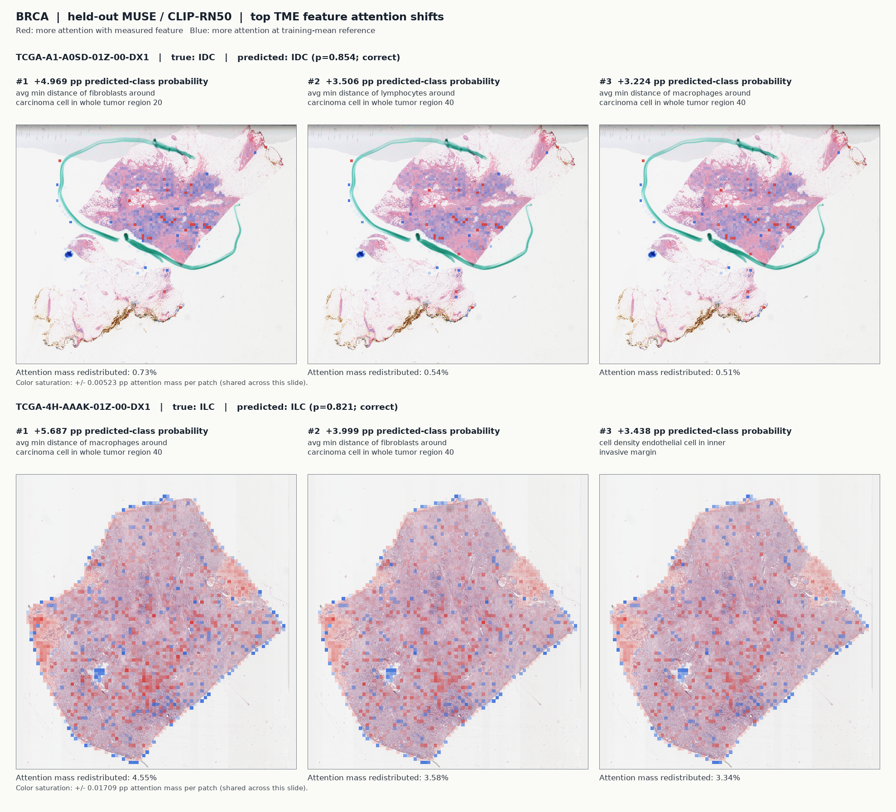

# TME-Adapter feature-conditioned attention on real WSI thumbnails

These four figures explain the **saved 16-shot, fold-0 PathoTME-Adapter MUSE/CLIP-RN50 models**. Each row is a real held-out TCGA slide; the slides are the first lexicographic held-out slide of each true class in BRCA, NSCLC, CRC, and BLCA. Each column is one of the **three measured TME features that most support that slide's predicted class**. Features were ranked by rerunning the complete saved model after replacing one standardized TME input with its training-fold reference.

| Cohort | Two-slide figure | Prediction caveat |
|---|---|---|
| BRCA | [Top-feature attention shifts](brca_top_feature_attention.png) | Both slides classified correctly; IDC attention shifts are small. |
| NSCLC | [Top-feature attention shifts](nsclc_top_feature_attention.png) | Both fixed slides are misclassified; scores support the displayed *predicted* class. |
| CRC | [Top-feature attention shifts](crc_top_feature_attention.png) | Both slides classified correctly. |
| BLCA | [Top-feature attention shifts](blca_top_feature_attention.png) | Both slides classified correctly; non-papillary feature effects are small. |



## What the colors and numbers mean

For predicted class \(c\), observed TME vector \(z\), and feature \(j\), the number above a panel is

\[
\Delta p_j=100\,[p_c(X,z)-p_c(X,z_{j=0})]
\]

in **percentage points**. The replacement \(z_{j=0}\) sets one feature to zero *after the saved fold standardizer*, which represents the transformed training-fold mean. Positive values support the predicted class under this reference comparison. The top three positive values are chosen independently for each slide; scores are reference-dependent and do not add up to the prediction.

At each exact consumed patch coordinate, the colored tile shows \(A_c(X,z)-A_c(X,z_{j=0})\), where \(A_c\) is MUSE's class-query patch attention after its normal top-patch selection and expert routing. **Red** means more attention with the measured TME feature; **blue** means more attention at the training-mean reference. The percentage beneath each panel is \(50\sum_i|A_{c,i}(X,z)-A_{c,i}(X,z_{j=0})|\): the fraction of normalized attention mass redistributed. Color saturates at the 99th percentile of absolute patch changes, with a shared scale for the three panels **within one slide**; the numeric saturation is printed under each row. Between-slide color intensity is not directly comparable.

This is an **adapter attention-shift map**, not a map of where macrophages, fibroblasts, plasma cells, or other measured features physically occur. The OpenTME cell-density and neighborhood measurements available for these examples are slide-level inputs. Nor does attention change itself establish which patch caused a probability change. The signed probability score and attention shift answer different questions. The images contain original WSI marks and background; colored tiles are drawn only at patch coordinates consumed by the model. No synthetic patches or interpolated tissue scores are used.

## Reproduce from the saved model and original WSI

The renderer verifies the completed run, checkpoint hashes, held-out membership, saved prediction, fitted standardizer, and consumed HDF5 patch-coordinate alignment. Set `PGVL_ROOT` if `PGVL-Gym` is not a sibling of this repository. A single-slide export needs the original unrotated WSI:

```bash
python scripts/render_adapter_feature_attention.py \
  --completion "$MUSE_BRCA_FOLD0/fold_complete.json" \
  --slide-id TCGA-4H-AAAK-01Z-00-DX1 \
  --wsi "$BRCA_ILC_WSI" \
  --output-dir "$OUTPUT_DIR"
```

For several slides, pass `--manifest cases.tsv`. The tab-separated manifest has columns `completion`, `slide_id`, `wsi`, `thumbnail`, `level0_width`, `level0_height`. Fill either `wsi` or `thumbnail`; a full-slide, unrotated thumbnail requires both level-0 dimensions. Keep model inputs, full WSIs, and the manifest outside the public repository. The published [summary](summary.json) contains slide IDs, predictions, top-feature scores, attention-redistribution values, and checkpoint/thumbnail hashes, with no local paths or raw TME rows. The [GDC source manifest](../qualitative-heatmaps/source_wsis.tsv) identifies the eight original WSIs.

**Suggested caption.** “Held-out TCGA WSI thumbnails from saved 16-shot PathoTME-Adapter MUSE/CLIP-RN50 fold-0 models. The three columns in each row are the slide's largest positive measured-TME feature effects on its *predicted-class* probability, evaluated by one-feature replacement with the saved training-fold reference. Red/blue tiles show patch-attention gain/loss under measured versus reference TME at exact consumed patch coordinates; numbers report prediction change in percentage points and total attention redistribution. The NSCLC examples are misclassified. The maps show model attention changes, not spatial locations of slide-level TME measurements or causal patch effects.”

Source data: TCGA/GDC whole-slide images and the gated OpenTME measurement release. The full WSIs, HDF5 features, and raw TME measurement rows are not redistributed here.
