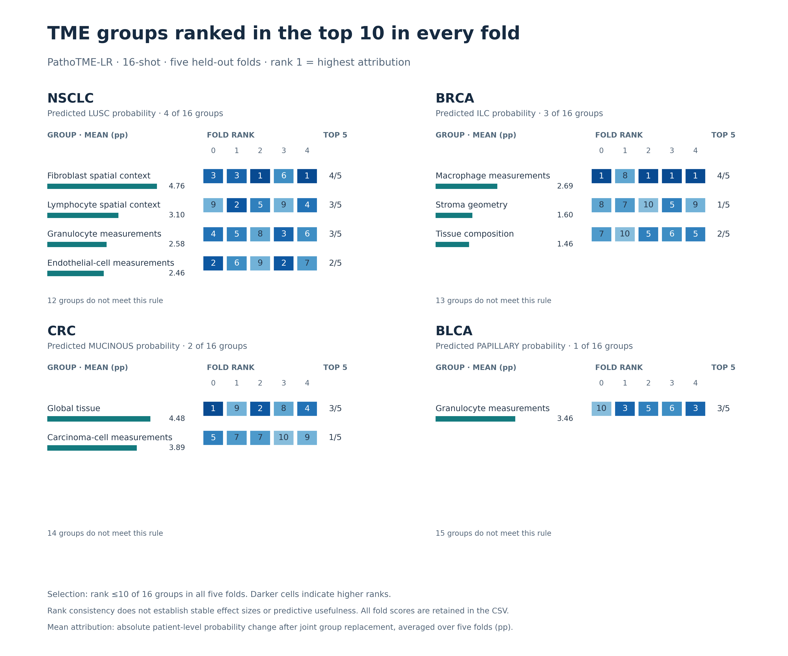

# Groups ranked in the top 10 in every fold

[PNG](lr_consistent_groups_16shot.png) · [SVG](lr_consistent_groups_16shot.svg) · [PDF](lr_consistent_groups_16shot.pdf)



This figure shows **PathoTME-LR biological groups with rank ≤10 of 16 in each
of the five held-out folds**, independently for each cancer. The same rule is
applied to every group and cohort. Every qualifying group is shown, ordered by
its five-fold mean absolute attribution. This is a descriptive selection from
the existing results, not independent validation or a significance test.

Bars and numeric labels report the mean absolute patient-level probability
change in percentage points (pp). Each heatmap cell gives the group's rank in
that fold; 1 is the highest attribution and darker cells mean higher ranks.
The **Top 5** column reports the number of folds in which the group ranks ≤5,
providing a stricter description alongside the top-10 selection rule.

| Cancer | Groups meeting the rule | Groups excluded |
|---|---:|---:|
| NSCLC | 4 | 12 |
| BRCA | 3 | 13 |
| CRC | 2 | 14 |
| BLCA | 1 | 15 |

Top 10 of 16 is a broad rank threshold. A group can pass while its effect
magnitude varies considerably between folds. This figure supports claims
about repeated high ranking under that explicit rule, not stable effect
sizes, improved prediction accuracy, causal biology, or image–TME interaction.
It describes the TME-only LR reference, not the unfinished learned adapters.

[All 64 candidate groups](all_lr_group_consistency.csv) includes selected and
excluded groups, their exact names, five ranks, five attribution scores, mean,
sample SD, top-10 and top-5 fold counts, and selection status. The source
[rankings](../../feature_rankings.csv) and [fold scores](../../fold_feature_scores.csv)
are preserved. No patient-level data or model refitting is needed.

Run from the repository root with Python and Matplotlib:

```bash
python docs/data/attribution-16shot-20261004/figures/make_consistent_groups.py
```
